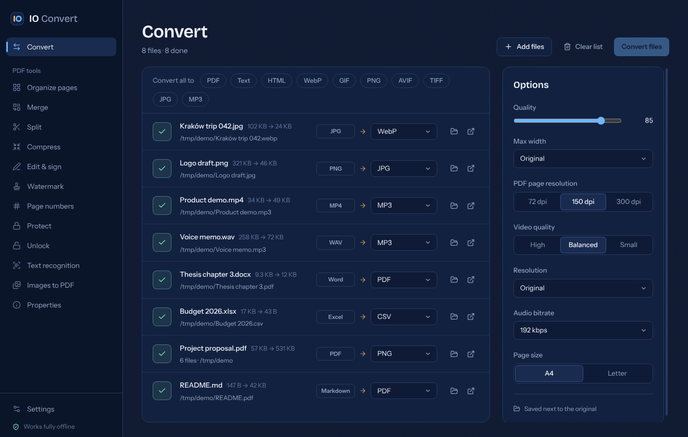
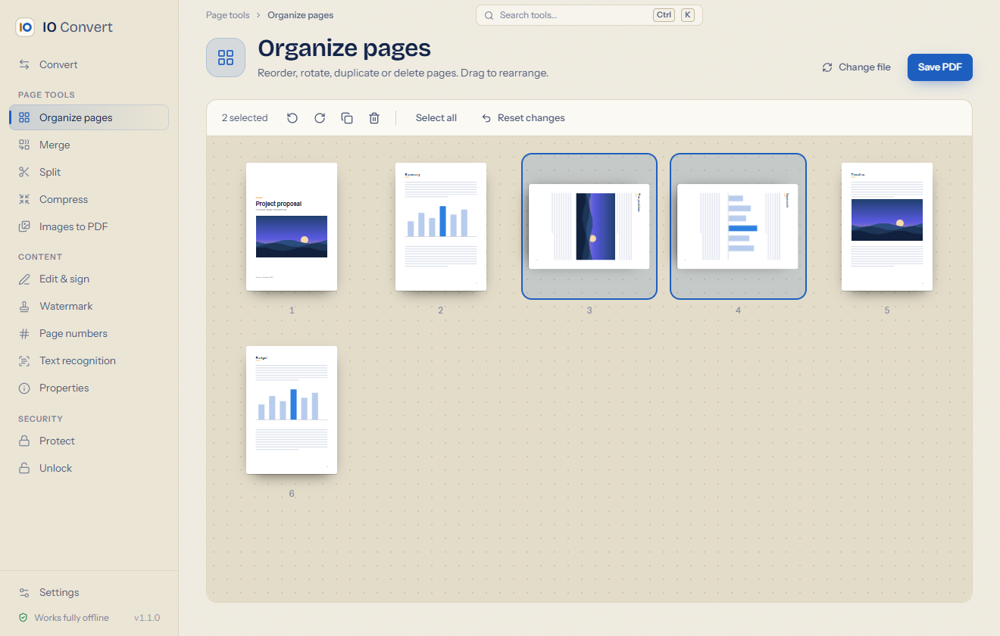
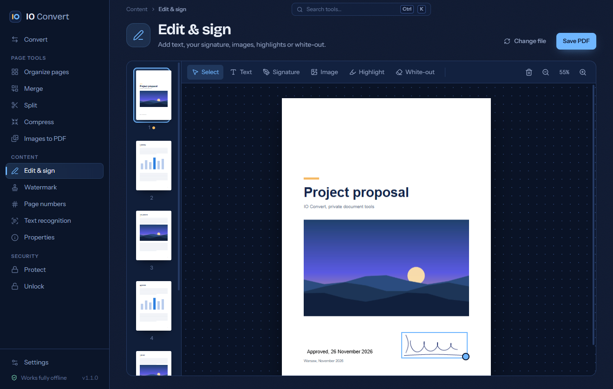
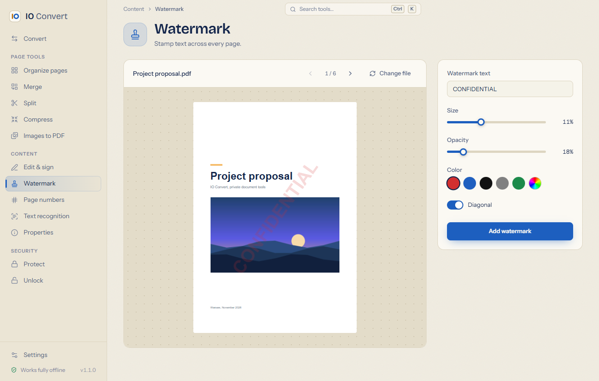
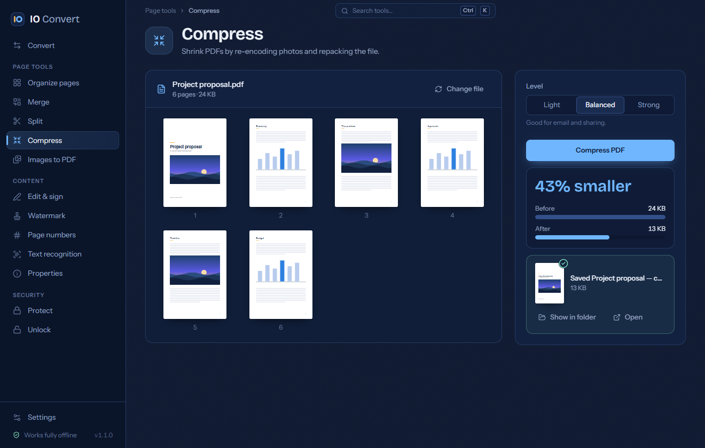
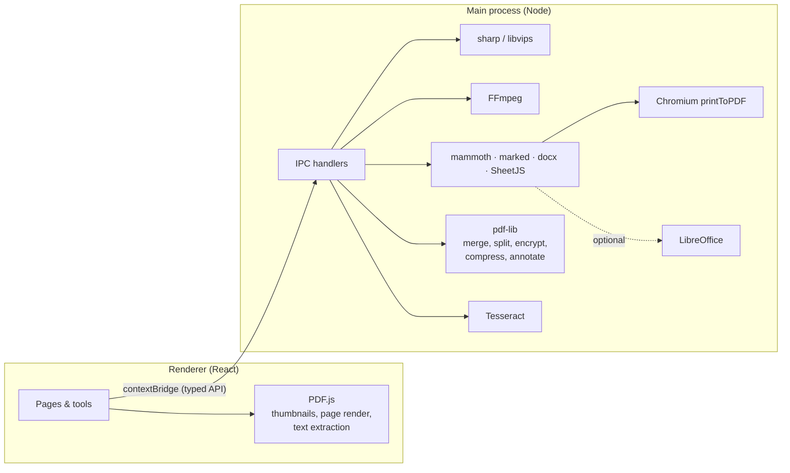

<div align="center">


# IO Convert

**Convert files and edit PDFs on your desktop. Nothing is uploaded.**

A private alternative to online converters: images, video, audio, documents, spreadsheets and PDFs, handled entirely on your own computer.

[](https://github.com/sm3th/io-convert/actions/workflows/ci.yml)
[](https://github.com/sm3th/io-convert/releases/latest)




**[Download for Windows](https://github.com/sm3th/io-convert/releases/latest)**

</div>

## Download

Get `IO.Convert.Setup.x.y.z.exe` from the [latest release](https://github.com/sm3th/io-convert/releases/latest) and run it.

The installer is not code-signed yet, so Windows SmartScreen may show *"Windows protected your PC"*. Choose **More info → Run anyway** to continue. macOS and Linux builds can be made from source (see [Getting started](#getting-started)).

## Why

Free online converters ask you to upload contracts, IDs and invoices to servers you know nothing about. IO Convert does the same jobs locally, so your files never leave your computer. It works without an internet connection, has no accounts and shows no ads.

## Features

### Convert anything

Drop in a mixed batch and choose a target format for each file, or set one for all of them. Files are processed two at a time, with live progress and a cancel button.

| From | To |
|---|---|
| **Images:** PNG, JPG, WebP, AVIF, TIFF, GIF, HEIC (iPhone), SVG | PNG, JPG, WebP, AVIF, TIFF, GIF, PDF, text (OCR) |
| **Video:** MP4, MOV, MKV, WebM, AVI, WMV, FLV, M4V… | MP4, WebM, MKV, MOV, AVI, animated GIF, MP3, WAV, M4A, FLAC, OGG |
| **Audio:** MP3, WAV, FLAC, AAC, M4A, OGG, Opus, WMA, AIFF | MP3, WAV, FLAC, M4A, OGG, Opus |
| **Documents:** DOCX, Markdown, HTML, TXT (+ DOC, ODT, RTF, PPTX with LibreOffice) | PDF, DOCX, HTML, TXT, Markdown |
| **Spreadsheets:** XLSX, XLS, ODS, CSV, TSV, JSON | XLSX, CSV, JSON, HTML, PDF, ODS |
| **PDF** | PNG, JPG, WebP (one file per page), TXT, DOCX, HTML |

You can set image quality and maximum width, video quality, resolution and audio bitrate, GIF frame rate, PDF render resolution (DPI) and page size.

### PDF toolkit

| Tool | What it does |
|---|---|
| **Organize pages** | Thumbnail grid with drag and drop: reorder, rotate, duplicate and delete pages. Supports multi-select with Ctrl and Shift. |
| **Edit & sign** | Add text, a hand-drawn signature, images, highlights or white-out. You place each item on the page and drag or resize it. |
| **Merge / Split** | Combine PDFs in any order. Split by ranges (`1-3, 5, 8-`), into single pages, or into chunks of N pages. |
| **Compress** | Re-encodes embedded photos and repacks objects. Never returns a file larger than the original. |
| **Protect / Unlock** | AES-256 encryption with print, copy and edit permissions. Can remove a password you know. |
| **Watermark / Page numbers** | Live preview before you save, with full Unicode support (ş, ğ, ı, ł, ą…). |
| **Text recognition (OCR)** | Turns scans and photos into searchable PDFs or plain text, in English, Turkish, Polish and German. |
| **Images to PDF** | Puts photos into one PDF, either on A4 pages or with each page matching its image. |
| **Properties** | View and edit the title, author, subject and keywords. |

Password-protected PDFs work in every tool: the app asks for the password once and remembers it for that file.

<table>
<tr>
<td></td>
<td></td>
</tr>
<tr>
<td></td>
<td></td>
</tr>
</table>

The interface is available in **English and Turkish**. It picks the language from your system and you can switch it in Settings.

## Getting started

Requires **Node.js 20+**.

```bash
git clone https://github.com/sm3th/io-convert.git
cd io-convert
npm install          # also downloads FFmpeg and copies PDF.js assets
npm run dev          # start with hot reload
```

| Script | |
|---|---|
| `npm run dev` | Run the app in development mode |
| `npm test` | Run the conversion and PDF test suite (Vitest) |
| `npm run typecheck` | Run strict TypeScript over main, preload and renderer |
| `npm run dist:win` | Build a Windows installer into `dist/` |

**Optional:** install [LibreOffice](https://www.libreoffice.org/download/) to enable DOC, ODT, RTF and PowerPoint conversion. IO Convert finds it automatically and also uses it for higher-fidelity Word → PDF output.

Pushing a tag such as `v1.0.0` runs the release workflow, which builds the Windows installer and attaches it to a GitHub Release.

## How it works



- **Security:** the renderer is sandboxed, runs with `contextIsolation` and without Node integration, under a strict Content Security Policy. It reaches the main process only through a small typed API exposed by the preload script. The window cannot be navigated away from the app, and release builds hide the reload and DevTools shortcuts. Electron fuses turn off `ELECTRON_RUN_AS_NODE`, `NODE_OPTIONS` and the inspector flags, so the installed app cannot be used as a general Node.js runtime.
- **The right engine for each job:** pixel work runs on libvips through sharp, media on FFmpeg, and PDF structure on pdf-lib. PDF *rendering* happens in the renderer with PDF.js, which also powers PDF → image and PDF → text conversion.
- **Correct PDF geometry:** annotations are stored as fractions of the page *as the user sees it*. They are mapped back to PDF space for every `/Rotate` value, so signatures land in the right place on rotated scans too.
- **Real compression:** `compress` walks the PDF object graph, decodes JPEG and raw RGB/gray image streams, downsamples and re-encodes them, and repacks everything into object streams.
- **Readable errors:** every IPC call returns `{ ok, value | error }`, so failures show up in the UI as plain messages in the interface language rather than stack traces. A crash in one screen is contained by an error boundary and never blanks the whole window.

### Project structure

```
src/
├─ main/               Electron main process
│  ├─ index.ts         window, IPC, Chromium PDF printer
│  └─ services/        image · media · document · pdf · ocr · convert router
├─ preload/            typed bridge exposed as window.io
├─ renderer/src/
│  ├─ pages/           Convert, Organize, Editor, Merge, Tools, Settings
│  ├─ components/      UI kit, PDF tool layout, thumbnails
│  └─ lib/             PDF.js helpers, i18n (EN/TR), hooks
└─ shared/formats.ts   format matrix and IPC types, used by both sides
tests/                 end-to-end service tests and i18n tests (47)
```

## Design

The visual direction is a **cyanotype darkroom**: Prussian-blue ink surfaces, paper-white type and cyan accents. Work in progress shows as an amber "developing" stripe that settles into cyan when a job is done. Headings use *Bricolage Grotesque* and the interface uses *Instrument Sans*. The only ambient motion is the format ticker on the start screen, and it is turned off when the system asks for reduced motion.

## Roadmap

- [ ] Batch PDF tools (compress or watermark many files at once)
- [ ] Fill and flatten PDF forms
- [ ] Redaction that removes the underlying text, not just covers it
- [ ] Polish UI translation
- [ ] Signed installers and auto-update

## Contributing

Bug reports, translations and pull requests are welcome. See [CONTRIBUTING.md](CONTRIBUTING.md) for setup and guidelines, and [SECURITY.md](SECURITY.md) to report a vulnerability privately. Changes between versions are listed in [CHANGELOG.md](CHANGELOG.md).

## Third-party software

IO Convert bundles [FFmpeg](https://ffmpeg.org) (via `ffmpeg-static`, GPL), [libvips](https://www.libvips.org) (via `sharp`, LGPL), [PDF.js](https://mozilla.github.io/pdf.js/) (Apache-2.0), [pdf-lib](https://github.com/cantoo-scribe/pdf-lib) (MIT), [Tesseract.js](https://tesseract.projectnaptha.com) (Apache-2.0), [SheetJS CE](https://sheetjs.com) (Apache-2.0) and the Liberation Sans font (SIL OFL 1.1, see `resources/fonts`). Their licenses apply to those components.

## License

[MIT](LICENSE) © 2026 İsmet Organ · IO Software
